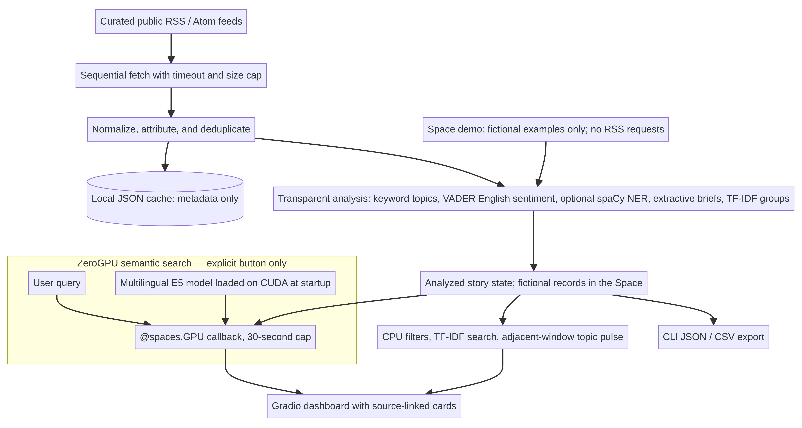

# AI News Intelligence

An RSS-first news analysis desk that collects public headlines and short feed descriptions, labels broad topics, estimates English sentiment, extracts candidate entities, groups near-duplicate coverage, and presents source-linked story cards in a Gradio interface.

**Status:** working first version (`0.1.0`). This is an inspectable prototype, not a validated newsroom or fact-checking system. It does not scrape article pages, generate claims with an LLM, or claim a trained news classifier.

## Why this project

News readers often have to scan several sources to notice recurring coverage and broad themes. This project demonstrates an end-to-end data product while keeping the provenance visible: each card links to its publisher, uses only RSS fields, and marks analysis method/limitations explicitly. A bilingual feed is included to make Amharic support a real design constraint rather than a marketing claim.

## Features

- Sequential RSS/Atom fetching with timeouts, a 5 MB response cap, canonical links, and duplicate removal.
- Four configured feeds, including BBC News Amharic and Ethiopia-focused English coverage; endpoints are editable in [`config/feeds.json`](config/feeds.json).
- Broad topic labeling with an explainable keyword baseline; evidence share is not a probability.
- English-only VADER sentiment; Amharic is marked unsupported, not mislabeled.
- Optional English spaCy NER (`en_core_web_sm`) with a disclosed capitalization-candidate fallback.
- Short extractive briefs from publisher-provided feed descriptions (no generated summary and no full article text).
- Related-story groups using TF-IDF word/bigram cosine similarity.
- Gradio filters for topic, sentiment, exact-text search, and Ethiopia-focused sources; source attribution and original-story links.
- Similarity-ranked search using TF-IDF by default, with optional multilingual sentence embeddings.
- On Hugging Face Spaces, an explicit button runs pinned multilingual E5 semantic search on ZeroGPU, using only fictional examples; it requests GPU time only when clicked and is capped at 30 seconds. Amharic relevance is not benchmarked.
- A descriptive topic pulse comparing currently returned feed items across adjacent seven-day windows; source feed histories are incomplete, so it is not comprehensive coverage or a forecast.
- Local JSON cache, CLI JSON/CSV export, and offline unit tests.
- Automatic synthetic-data mode on Hugging Face Spaces; it avoids live RSS requests and labels fictional examples explicitly.



## Quick start

Python 3.10+ is supported. From the repository root:

```bash
python -m venv .venv
source .venv/bin/activate  # Windows: .venv\\Scripts\\activate
python -m pip install -e ".[test]"
```

This local install keeps the Space-only PyTorch/ZeroGPU model stack out of the default environment. Hugging Face Spaces installs the pinned runtime dependencies in [`requirements.txt`](requirements.txt).

Launch the interface locally:

```bash
python app.py
```

Open `http://127.0.0.1:7860`. Local development uses the configured live feeds and falls back to the last cache when the network is unavailable. For a fictional, no-network preview, launch with `NEWSINTEL_DEMO_MODE=1 python app.py`. A Hugging Face Space automatically switches to synthetic examples when `SPACE_ID` is present; it will not fetch live feeds or show publisher excerpts.

Run the pipeline without a browser:

```bash
newsintel --output news.json
newsintel --output news.csv
newsintel --cached
```

Run the test suite offline:

```bash
pytest
```

For higher-quality English named-entity extraction, install the optional package and model:

```bash
python -m pip install '.[ner]'
python -m spacy download en_core_web_sm
```

For optional multilingual embedding search during local development, install `python -m pip install -e '.[semantic]'` and set `NEWSINTEL_SEARCH_MODEL` to a compatible sentence-transformers model ID. The model is downloaded on first similarity search. If it is unavailable, the application falls back to TF-IDF and reports the active backend. The public Space uses a separate pinned E5 model on ZeroGPU; see [`docs/sources.md`](docs/sources.md). E5's model card cautions that low-resource languages may see degraded performance, and this project has no Amharic search benchmark.

If that model is absent, the app returns capitalization-based *candidate* names with the fallback method disclosed in each record. The fallback is not a substitute for validated NER.

## Analysis and evaluation

This first version prioritizes honest, reproducible baselines over unsupported benchmark claims. Topic labeling uses keyword rules; sentiment uses VADER's English lexicon; related-story clustering uses lexical TF-IDF. Search can use TF-IDF by default or optional dense sentence embeddings when configured. These methods can miss context, irony, uncommon topics, and paraphrases. Headlines and short feed descriptions are particularly weak evidence for sentiment or entities. Trend counts compare adjacent windows only within the currently returned, incomplete feed sample; they are neither comprehensive nor predictive.

No labeled evaluation corpus is included, so there are **no precision/recall/F1 or clustering-quality claims**. The tests cover data normalization, unsafe URLs, supported/unsupported-language behavior, output fields, grouping on a synthetic unit-test fixture, and cache schema behavior. The fixture is synthetic test data, not a news dataset. See [`docs/architecture.md`](docs/architecture.md) and [`docs/sources.md`](docs/sources.md).

The verified test count, live-feed smoke check, and local dashboard check are recorded in [`docs/evaluation.md`](docs/evaluation.md); live counts are point-in-time operational evidence, not model benchmarks.

## Data rights and responsible use

The tool reads public RSS/Atom endpoints only and stores feed metadata and short publisher-supplied descriptions locally. Feed availability does not grant a right to republish content. BBC guidance describes personal/non-commercial use; Al Jazeera restricts redistribution without permission; and The Reporter's applicable feed permissions remain unclear. For that reason, the public demo is not being deployed with live excerpts until rights are clearer. Attribution and links are retained. Do not add article-body scraping, bypass access controls, or redistribute feed content without permission. See [`docs/sources.md`](docs/sources.md).

## Configuration

Edit `config/feeds.json` to add/remove sources. Each entry has `name`, `url`, `homepage`, `language`, `region`, and `attribution`. `language: "am"` disables unvalidated English-only sentiment and NER. Runtime cache files are written to `data/` and ignored by Git.

## Repository layout

```text
app.py                 Gradio interface
newsintel/             RSS, analysis, pipeline, cache, CLI
config/feeds.json      Feed source configuration
tests/                 Offline tests and clearly synthetic XML fixture
docs/                  Architecture and source notes
```

## Hugging Face / deployment

The [public synthetic-only Space](https://huggingface.co/spaces/klohdfhk/ai-news-intelligence) contains code and fictional examples only—no publisher stories or feed dataset are uploaded. Its earlier runtime failed because the app had no `@spaces.GPU` handler. The current source adds a genuine multilingual E5 search callback on ZeroGPU; a public rebuild and live inference check are pending, so do not treat the hosted runtime as verified yet. GPU time is requested only by the explicit search button, with the default hardware size and a 30-second cap. Free personal ZeroGPU hosting depends on [account eligibility and daily quotas](https://huggingface.co/docs/hub/spaces-zerogpu); no paid CPU plan or larger GPU size has been enabled. The Space remains synthetic-only and never fetches live RSS. Live excerpts stay local-only pending clearer reuse permission.

## License

Original project code is licensed under MIT; see [`LICENSE`](LICENSE). This license does not apply to feed content owned by publishers.
