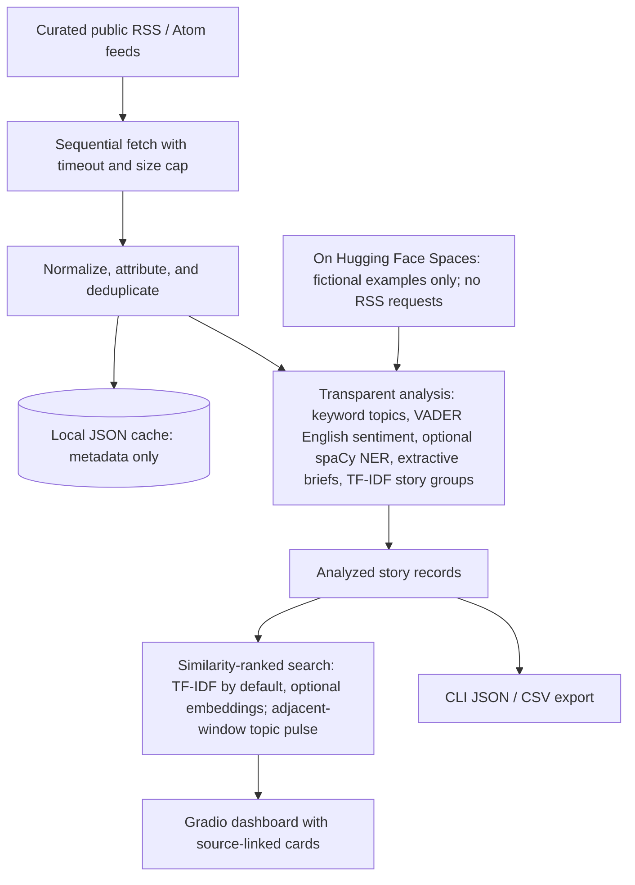

# Architecture

The system does not crawl article pages, send content to a third-party LLM, or train a classifier on unlabelled headlines. Feed items are fetched sequentially to avoid unnecessary load. Each displayed item links to its publisher and retains attribution. The cache stores normalized feed fields only and is excluded from Git.

## Analysis components

- **Topic classification:** transparent keyword matching over headline and RSS description. The evidence share is not a calibrated probability.
- **Sentiment:** VADER lexicon scoring for English. Amharic and text without Latin-script evidence are labeled unsupported rather than assigned an unvalidated score.
- **Entities:** optional `en_core_web_sm` spaCy NER. If the model is not installed, a clearly labeled capitalization heuristic proposes candidate names. Neither path is validated for Amharic.
- **Related stories:** TF-IDF word/bigram vectors with cosine similarity and a connected-components grouping threshold. This is a lightweight lexical baseline, not semantic embedding search.
- **Search:** exact-text matching or ranked TF-IDF similarity by default. An optional sentence-transformers model can provide dense multilingual embeddings; the UI reports the active backend and falls back to TF-IDF if model loading fails.
- **Topic pulse:** compares current-window topic counts with the preceding window using only feed items presently available to the app. Feed histories are incomplete, so the pulse is not comprehensive coverage, a forecast, or a measure of article truth.
- **Brief summaries:** at most two sentences selected from the publisher-provided RSS description; title-only if the feed provides no description. No generative model is used.

A stronger version should add an annotated, licensed benchmark and report held-out topic/sentiment/NER results before replacing these inspectable baselines.
